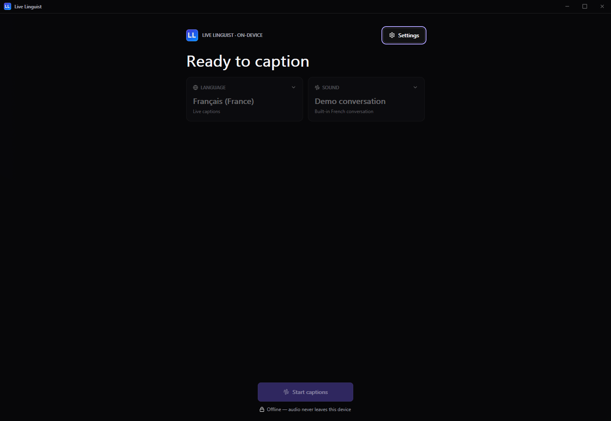
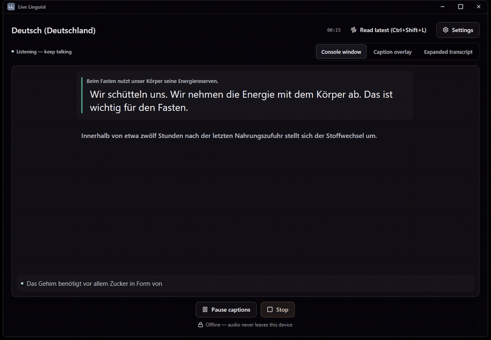
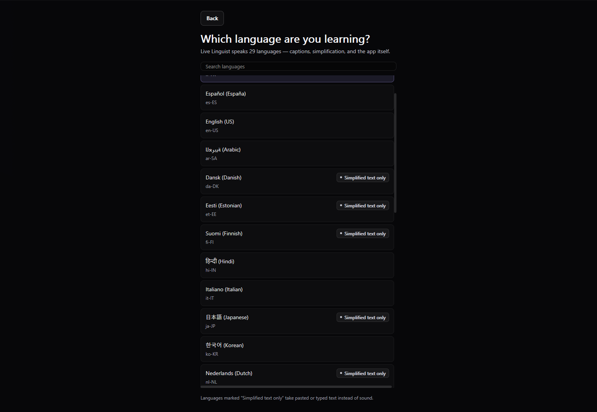
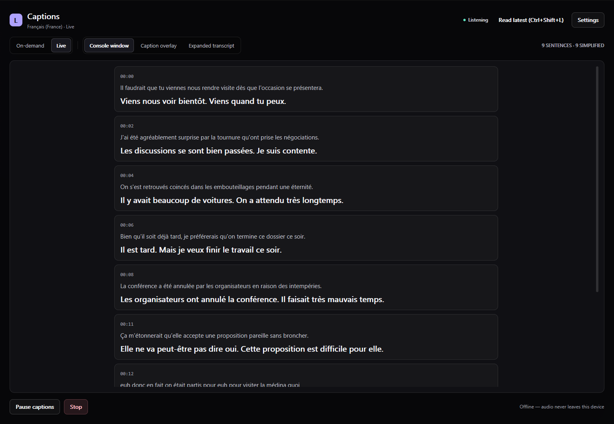
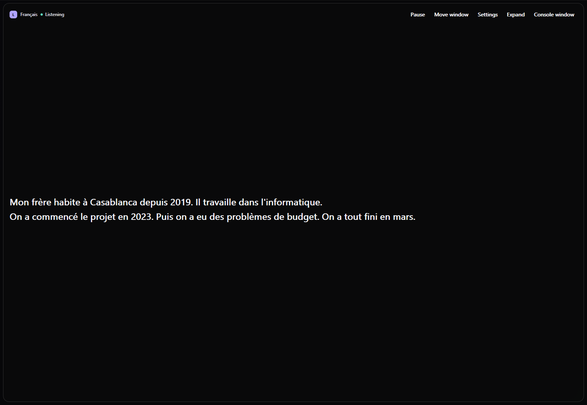
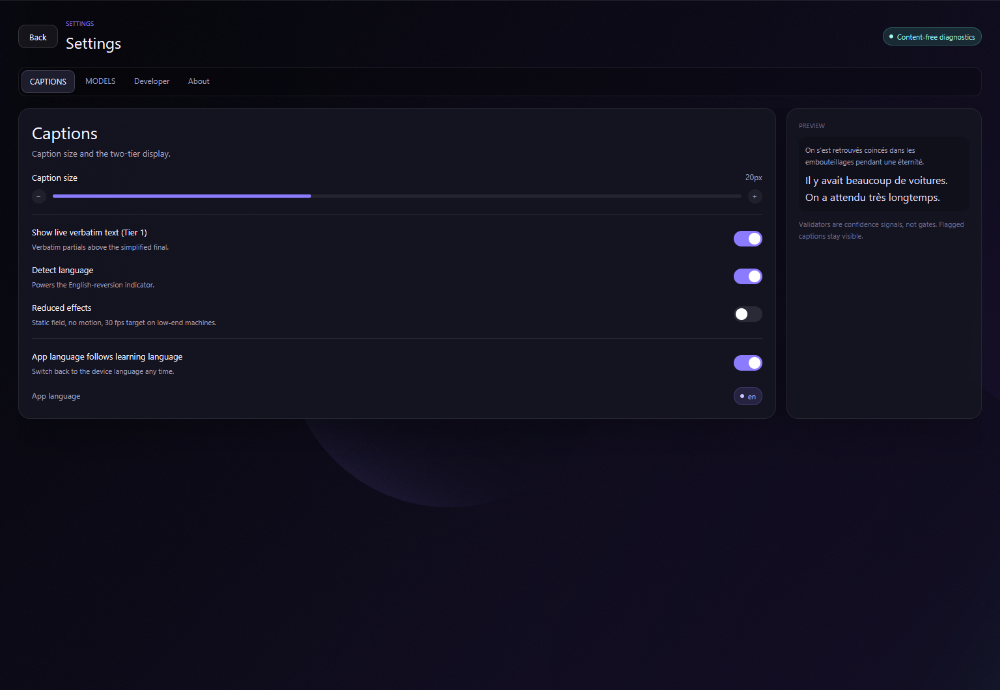
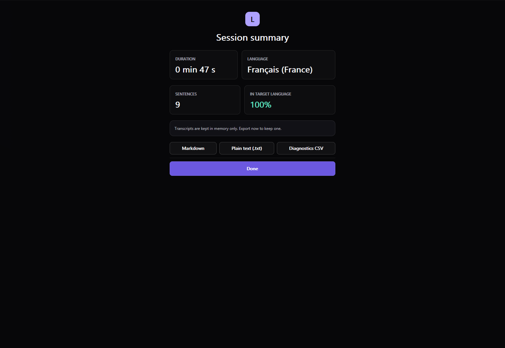

# Live Linguist PC

Native, on-device **same-language simplification captions** for Windows 11 x64,
built with a Rust core and a GPUIX + React UI. Linux x86-64 is the
development/evaluation environment. No translation, no cloud, no audio leaving
the machine.

This repo is the PC spin-out of [live-linguist](https://github.com/ngoldbla/live-linguist)
(the macOS/iOS app). The product conceit is unchanged: a learner hears authentic
native-speed speech and reads the same content rendered into the official
easy-language register for that language — **FALC**, **Leichte Sprache**,
**Easy English**, **Lectura Fácil**, and 25 further locales.



## What it does

1. Choose the language you are learning and the sound to listen to.
2. Press **Start captions**. Speech is transcribed on the CPU as it plays.
3. Click any sentence to see the same sentence in simpler words, in the same
   language. Nothing is translated, and nothing leaves the PC.

The window starts as a small console, can collapse into a 780×250 caption
overlay over any app, and keeps the spoken line above the simpler one so you can
compare them. Caption size, the original-line toggle, and the app language are
remembered between runs.

## Download for Windows

**[Download the current Windows build](https://github.com/ngoldbla/livelinguist-pc/releases)**:
under **Assets**, get `LiveLinguist-<version>-setup.exe` for the installer or the
portable ZIP. The current candidate is **`v1.0.0-rc.4`**. Open the file and click
**Install**; no admin rights are needed.

- **"Windows protected your PC"?** The app is not code-signed yet. Click
  **More info**, then **Run anyway**. Each release lists SHA-256 hashes so you
  can check the file.
- **First start:** it downloads the speech and simplification models once
  (about 1.1 GB), then works offline. Audio never leaves your PC.
- **Needs:** Windows 11, 64-bit Intel or AMD PC, 8 GB memory, about 2.5 GB disk.
- Release candidates are pre-releases, so the repository's "latest release" link
  skips them. All builds are on the [releases page](https://github.com/ngoldbla/livelinguist-pc/releases).

## Watch it run

A real 60-second German run on Windows: system audio captured through WASAPI
loopback, sherpa-onnx transcribing on the CPU, and every second finalized
sentence clicked for a llama.cpp simplification. The UI is English; the captions
are German.

[](docs/media/german-60s.mp4)

*30-second preview. [Watch the full 60-second MP4](docs/media/german-60s.mp4).*

Measured on that run: live partials at p50 1.87 s / p95 6.31 s, all 7 requested
clicks applied, and click-to-simplified at p95 2.27 s. Captions kept flowing
through the clicks. Full numbers and method:
[`docs/qa/2026-11-25-german-live-baseline.md`](docs/qa/2026-11-25-german-live-baseline.md).

The clip is *Wie Fasten den Stoffwechsel verändert* (3sat/nano, Terra X), CC BY
4.0, from [Wikimedia Commons](https://commons.wikimedia.org/wiki/File:Wie_Fasten_den_Stoffwechsel_ver%C3%A4ndert_(CC_BY_4.0).webm).
It contains only that public fixture's audio and captions.

## Screens

| | |
|---|---|
|  |  |
| **Console.** Pick a language, pick a sound source, press Start. **Settings** stays one click away. | **Any of 29 languages.** Languages without a live-ASR gate are marked *Simplified text only* and take pasted or typed text instead of sound. |
|  |  |
| **Live captions.** The spoken sentence stays visible above the simpler version. Click a sentence at any time; captions keep flowing. | **Caption overlay.** A frameless 780×250 window over your video call or player, with pause, move, expand, and back to the console. |
|  |  |
| **Settings.** Caption size, show-or-hide the original line, other-language alerts, and the app language. | **Summary.** Session length, sentence count, target-language share, and content-free Markdown / text / diagnostics exports. |

Screens are 1536×1061 GPU test-renderer captures from the current UI, except the
overlay, which is a real GPUIX window. The video above is a real app run. The
full portfolio is in [`docs/screenshots/m2-windows/`](docs/screenshots/m2-windows/README.md).

## Scope (v1.0)

A single-screen Windows 11 x64 (23H2+) user installs per-user without admin,
plays a call or video, sees live verbatim captions from **system audio**
(WASAPI loopback) where the locale passes the ASR gate, and **clicks** any
sentence to get a same-language easy-language rewrite in any of the **29**
packs. Inference is CPU-only (sherpa-onnx Nemotron 3.5 ASR + llama.cpp Qwen3
0.6B EasyLanguage), models are downloaded on first run and hash-verified.

Not in 1.0: microphone, per-app capture, multi-monitor/mixed-DPI, GPU
inference, 1.7B, automatic simplification, Windows 10/ARM64, Linux/macOS
packages, translation, cloud. Full list: [`docs/plans/2026-11-22-v1-scope.md`](docs/plans/2026-11-22-v1-scope.md).

## Source of truth

- **Docs map:** [`docs/README.md`](docs/README.md) — start here
- **Execution plan (v1.0, Windows):** [`docs/plans/2026-11-23-windows-v1-plan.md`](docs/plans/2026-11-23-windows-v1-plan.md)
  and the copy-paste [agent prompt](docs/plans/2026-11-23-windows-agent-prompt.md)
- **v1.0 scope:** [`docs/plans/2026-11-22-v1-scope.md`](docs/plans/2026-11-22-v1-scope.md)
- **Progress board:** [`docs/qa/implementation-progress.md`](docs/qa/implementation-progress.md)
- **Decisions:** [`docs/decisions/`](docs/decisions/) (canonical ADRs)
- **Architecture reference:** [`docs/plans/2026-11-21-live-linguist-pc-master-plan.md`](docs/plans/2026-11-21-live-linguist-pc-master-plan.md)
- **Agent rules:** [`AGENTS.md`](AGENTS.md)

## Repository layout

```
core/crates/    Rust workspace: ll-core, ll-config, ll-audio, ll-asr, ll-llm,
                ll-models, ll-pipeline, ll-protocol, ll-bridge, ll-eval, ll-window
ui/             GPUIX 0.11 + React 19.2 + TypeScript
assets/packs/   29 canonical FrameworkPacks (ported verbatim from the Mac repo)
assets/locales/ 29 UI locale JSON files
tests/          golden inventory, fixtures, bridge harness
packaging/      NSIS + portable ZIP
docs/           plan, ADRs, QA evidence, screenshots, README media
```

## Build

Linux dev prerequisites: Rust 1.98 (pinned by `rust-toolchain.toml`), Bun 1.4.5,
Node 22+, Vulkan (lavapipe works for headless CI; a real GPU is better for the
window), X11 for the dev overlay, and the XCB development headers:
`sudo apt install libxcb1-dev libxcb-shape0-dev libxcb-xfixes0-dev`.

```bash
cargo test --workspace
cargo run -p ll-eval -- --scenario mock --out /tmp/ll-eval-out

cd ui
bun install --frozen-lockfile
bun run start
```

On a Wayland desktop, force X11 for overlay development:

```bash
env -u WAYLAND_DISPLAY bun ui/src/main.tsx
```

On Windows, build the app, installer, and portable ZIP locally:

```powershell
pwsh scripts/build-windows.ps1
pwsh scripts/test-installer.ps1 -Version 1.0.0-rc.4
```

## Status

`1.0.0-rc.4` is the current Windows release candidate. Working end to end:
WASAPI loopback capture, sherpa-onnx streaming ASR with 560 ms chunks, CPU
llama.cpp click-to-simplify, the 29 language packs, the console/overlay/expanded
windows, first-run model download, NSIS installer and portable ZIP, and the
tag-driven release workflow.

Still human-gated before `v1.0.0`: the Narrator and keyboard-only live run, the
100–150% scaling pass on the redesigned UI, and owner sign-off. The newest UI
strings are English placeholders in the 28 non-English UI catalogs.

## Design invariants (inherited)

- Never translate; same-language rewriting only.
- Never drop a finalized segment: a late or unsimplified caption beats no caption.
- Validators are confidence signals, not gates; fall back to verbatim with "≡".
- Degradation order: batch -> step down model size -> skip simplification
  (verbatim) -> never drop audio.
- Latency instrumentation is built in, and exports are content-free.
- Pinned model revisions and checksums; no silent model drift.
- No audio or transcript leaves the device.

## Reference

- Mac/iOS implementation: <https://github.com/ngoldbla/live-linguist>
- Product spec: `PRD.md` in the reference repo

## License

MIT (see [`LICENSE`](LICENSE)). Third-party components keep their own
licenses: [`packaging/licenses/THIRD_PARTY.md`](packaging/licenses/THIRD_PARTY.md).
Models are downloaded on first run and are not part of this repository.
