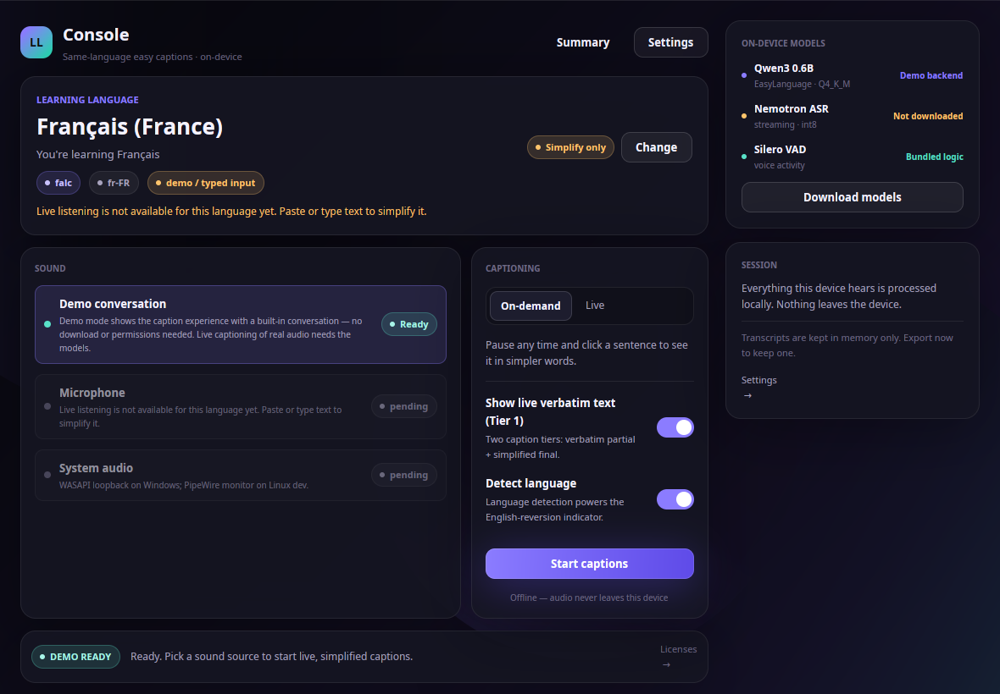
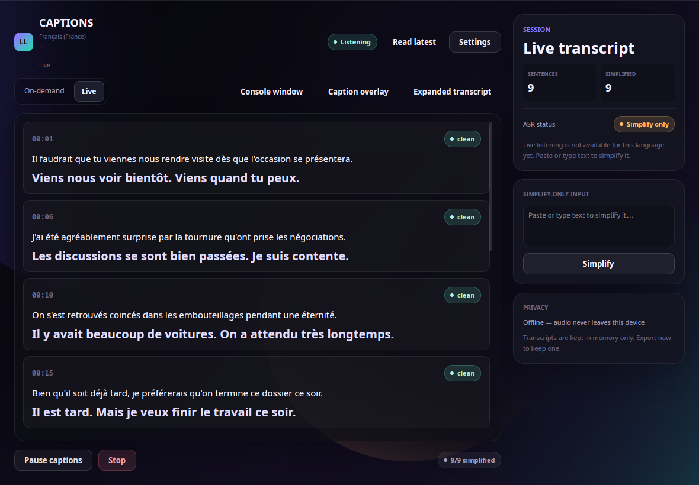
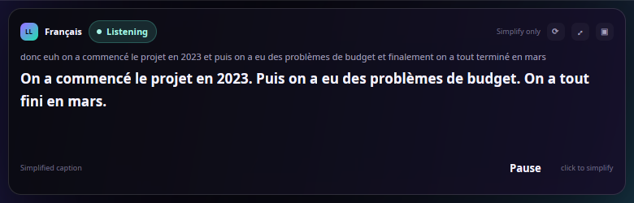

# Live Linguist PC

Native, on-device **same-language simplification captions** for Windows 11 x64,
built with a Rust core and a GPUIX + React UI. Linux x86-64 is the
development/evaluation environment. No translation, no cloud, no audio leaving
the machine.

This repo is the PC spin-out of [live-linguist](https://github.com/ngoldbla/live-linguist)
(the macOS/iOS app). The product conceit is unchanged: a learner hears authentic
native-speed speech and reads the same content rendered into the official
easy-language register for that language — **FALC**, **Leichte Sprache**,
**Easy English**, **Lectura Fácil**, and 25 further locales.

## Source of truth

- **Master plan:** [`docs/plans/2026-11-21-live-linguist-pc-master-plan.md`](docs/plans/2026-11-21-live-linguist-pc-master-plan.md)
- **Decisions:** [`docs/decisions/`](docs/decisions/) (canonical ADRs)
- **Progress board:** [`docs/qa/implementation-progress.md`](docs/qa/implementation-progress.md)
- **Agent rules:** [`AGENTS.md`](AGENTS.md)

## Scope (v1)

**In scope**

- **Windows 11 x64 (23H2+)** — the only product/release target.
- Linux x86-64 — development and evaluation only; no Linux package in v1.
- Full pipeline: audio -> VAD -> ASR -> endpointing -> segmentation ->
  simplification -> deterministic validation -> two-tier captions.
- On-demand simplification default; live mode behind advanced settings.
- 29 locales with explicit ASR coverage; simplify-only mode where streaming ASR
  is not usable.
- Console, caption overlay, transcript, settings, summary, onboarding, licenses.
- Export: Markdown, plain text, diagnostics CSV.
- Developer settings for CPU/GPU/mock/fault scenarios.
- Packaging: NSIS installer + portable ZIP for Windows 11 x64.

**Out of scope**

- Translation, cloud inference, mobile, ARM Linux, Windows ARM64, browser.
- Linux packaging/support in this plan (future track).
- Windows 10, speaker diarization, per-app capture (stretch), macOS/iOS shipping.

## Repository layout

```
core/crates/    Rust workspace: ll-core, ll-config, ll-audio, ll-asr, ll-llm,
                ll-models, ll-pipeline, ll-protocol, ll-bridge, ll-eval, ll-window
ui/             GPUIX 0.11 + React 19.2 + TypeScript
assets/packs/   29 canonical FrameworkPacks (ported verbatim from the Mac repo)
assets/locales/ 29 UI locale JSON files
tests/          golden inventory, fixtures, bridge harness
packaging/      NSIS + portable ZIP
docs/           plan, ADRs, QA evidence
```

## Build

Linux dev prerequisites: Rust 1.98 (pinned by `rust-toolchain.toml`), Bun 1.4.5,
Node 22+, Vulkan (lavapipe works for headless CI; a real GPU is better for the
window), X11 for the dev overlay, and the XCB development headers:
`sudo apt install libxcb1-dev libxcb-shape0-dev libxcb-xfixes0-dev`.

```bash
cargo test --workspace
cargo run -p ll-eval -- --scenario mock --out /tmp/ll-eval-out

cd ui
bun install --frozen-lockfile
bun run start
```

On a Wayland desktop, force X11 for overlay development:

```bash
env -u WAYLAND_DISPLAY bun ui/src/main.tsx
```

## Status

Implementation follows the master plan in validated stages. The core, bridge,
and UI are exercised on Linux dev; Windows hardware acceptance (Win32 overlay,
WASAPI loopback, D3D, packaging) is recorded when run on the Windows side.
See the progress board for the current stage and evidence.

Implemented and tested on Linux dev:

- 29 framework packs ported verbatim; deterministic core (prompts, segmenter,
  validators, reversion, metrics, exports) with golden tests.
- Protocol/config/audio/ASR/LLM/model/pipeline crates and a headless `ll-eval`
  CLI with content-free diagnostics.
- napi bridge with monotonic envelopes and a 100 events/s TSFN harness.
- GPUIX UI: onboarding, console, live/expanded transcript, compact overlay,
  settings, developer health card, summary, licenses; 29 locale catalogs.
- X11 EWMH overlay policy verified; Win32 policy compiles for the Windows target.
- NSIS/portable packaging configuration and a Windows release workflow.

UI portfolio: [`docs/screenshots/m2/`](docs/screenshots/m2/README.md).







## Design invariants (inherited)

- Never translate; same-language rewriting only.
- Never drop a finalized segment: a late or unsimplified caption beats no caption.
- Validators are confidence signals, not gates; fall back to verbatim with "≡".
- Degradation order: batch -> step down model size -> skip simplification
  (verbatim) -> never drop audio.
- Latency instrumentation is built in, and exports are content-free.
- Pinned model revisions and checksums; no silent model drift.
- No audio or transcript leaves the device.

## Reference

- Mac/iOS implementation: <https://github.com/ngoldbla/live-linguist>
- Product spec: `PRD.md` in the reference repo
