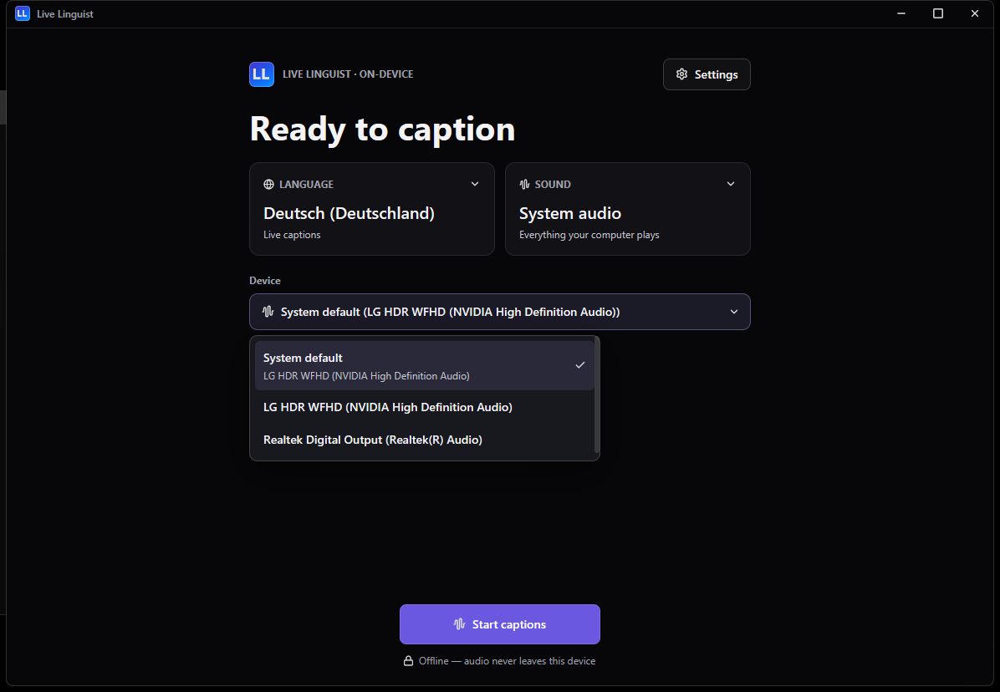

# Microphone capture and audio-endpoint selection — Windows evidence

- Date: 2026-11-25
- Host: Windows 11 Pro 10.0.26300, Ryzen 9 3900X, RTX 5060 Ti, one
  2560x1080 display.
- Scope: ADR 0028. `v1.0.0-rc.4` captured only Windows' default render endpoint
  and listed the microphone as unavailable.
- Status: implemented and verified on the reference host. Speech-recognition
  accuracy for microphone input is not measured here (the debug addon used for
  the UI pass has no ASR model).

## What changed

- `ll_audio::capture` exposes `CaptureKind::{Loopback, Microphone}`,
  `list_devices`, `default_device_id`, and one `DeviceCapture` that opens a
  selected endpoint or Windows' default. Both directions share the ring buffer,
  downmix and `rubato` 16 kHz path.
- Endpoint sample formats are converted to f32 in the callback instead of
  rejecting non-f32 devices.
- `listAudioSources` returns `devices` and `defaultDeviceId` for `monitor` and
  `mic`; `start` accepts `deviceId`. A missing or malformed explicit id is an
  `AUDIO_SOURCE_UNAVAILABLE` error, never a silent switch to another endpoint.
- The console adds a **Device** selector under the SOUND tile for system audio
  and microphone, refreshing endpoints when the SOUND menu opens. The choice is
  saved as `outputDeviceId` / `inputDeviceId`; empty follows Windows' default.
- A saved endpoint that is gone is dropped to the default with a visible toast
  at session start.

## Endpoints on the reference host

`cargo test -p ll-audio --features capture print_audio_endpoints -- --ignored
--nocapture`:

```text
system audio: 2 endpoint(s)
  default=true  id=wasapi:{0.0.0.00000000}.{15abc282-...}  name=LG HDR WFHD (NVIDIA High Definition Audio)
  default=false id=wasapi:{0.0.0.00000000}.{4dfe9c0e-...}  name=Realtek Digital Output (Realtek(R) Audio)
microphone: 1 endpoint(s)
  default=true  id=wasapi:{0.0.1.00000000}.{a55638c3-...}  name=Microphone (Realtek(R) Audio)
```

The earlier plan said the host had no microphone; Windows now exposes the
Realtek microphone endpoint, so microphone capture was exercised on hardware.

## Automated checks

```text
cargo fmt --all -- --check                         pass
cargo clippy -p ll-audio -p ll-bridge --features capture --all-targets -- -D warnings
                                                   pass
cargo test -p ll-audio --features capture          17 passed, 4 ignored (device tests)
cargo test -p ll-bridge --features capture         11 passed
(cd ui) bun run typecheck                          pass
(cd ui) bun test                                   114 passed
(cd ui) bun run check                              pass
```

Hardware-gated tests, all run explicitly with `--ignored`:

| Test | Result |
|---|---|
| `loopback_captures_playing_audio` | pass — fixture WAV heard through loopback |
| `microphone_opens_and_reports_its_endpoint` | pass — default mic opened, id and name present |
| `every_listed_endpoint_opens_by_id` | pass — both output endpoints and the input endpoint open by id |
| `print_audio_endpoints` | pass — list above |

## Bridge end-to-end

A debug `ll-bridge` build with `capture` (no ASR model) was loaded in Bun:
`listAudioSources` returned both endpoint lists, and starting `source: "mic"`
reached the listening state with a real capture and stopped cleanly.

```text
mic: available=true devices=1 default=wasapi:{0.0.1...}
monitor: available=true devices=2 default=wasapi:{0.0.0...}
state seq=1
stop ok: {"sessionId":"ses-000001","language":"de-DE","segments":0,
          "simplified":0,"durationS":1.17,"overrunCount":0,"lastSeq":2}
```

## Real-window UI pass

The debug addon was used for this pass only; it was replaced afterwards by a
current `capture,sherpa,llama` build.

1. Console shows SOUND; opening it lists **System audio**, **Microphone** (now
   enabled, "Your microphone or headset") and **Demo conversation**.
2. Selecting **System audio** reveals a **Device** tile labelled
   `System default (LG HDR WFHD (NVIDIA High Definition Audio))`.
3. The device menu lists the default entry, the LG HDMI output and the Realtek
   Digital Output. Selecting the Realtek output changes the tile to
   `Device: Realtek Digital Output (Realtek(R) Audio)`.


4. The choice persisted to
   `%LOCALAPPDATA%\LiveLinguist\ui-settings.json` as `outputDeviceId` with the
   Realtek endpoint id.
5. **Start captions** opened the live screen on the selected endpoint with the
   timer running; no `AUDIO_SOURCE_UNAVAILABLE` event was emitted.

This is a source-selection and capture check, not a caption-quality run: the
debug addon has no sherpa model. The German video in `docs/media/` remains the
end-to-end ASR evidence for system audio.

## Not claimed

- Microphone WER/latency. The pinned Nemotron model still needs a spoken
  microphone fixture and a measured row.
- Windows microphone permission denied path on this host (permission is granted).
- Hot-plugging an endpoint mid-session beyond the default-change path; an
  explicit endpoint is retried by id, then the session stops honestly.
- Multi-monitor, per-app loopback, or Linux end-to-end audio.

## Privacy

Microphone audio enters the same on-device pipeline as system audio. Nothing is
recorded, written to disk, or sent anywhere; the diagnostics events used here are
content-free. The endpoint names above are device labels, not transcript text.
